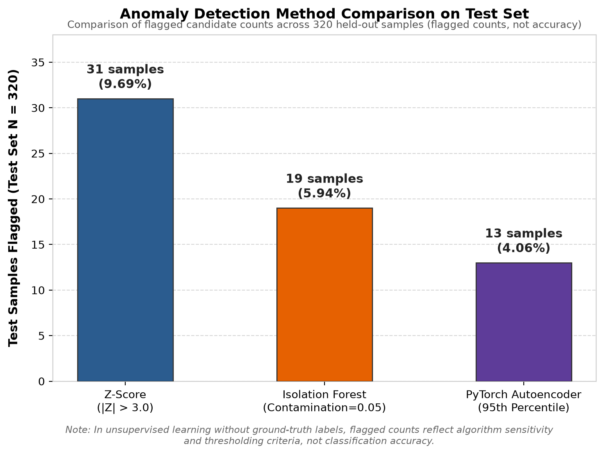
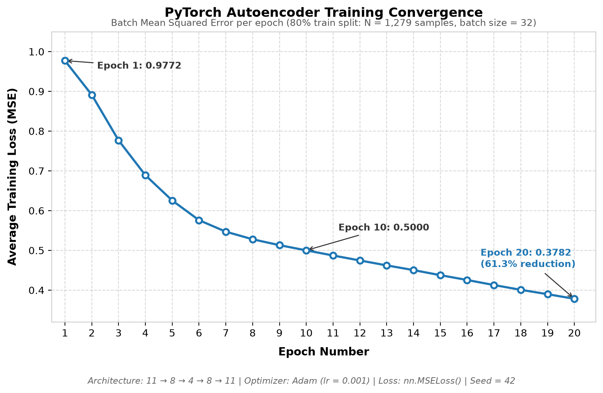
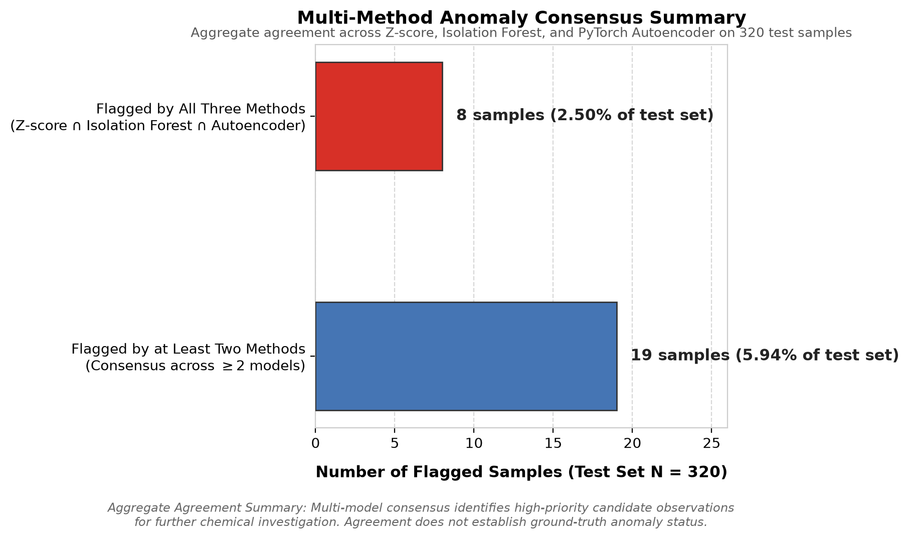

# Anomaly Detection in Red Wine Physicochemical Measurements

An exploratory Machine Learning project investigating unsupervised anomaly detection on the UCI Red Wine Quality dataset using statistical, machine learning, and deep learning techniques.

---

## 1. Project Overview

This project explores anomaly detection on multivariate tabular data using three distinct methodologies:

1. **Statistical**: Univariate / Multivariate Z-score thresholding
2. **Tree-based Machine Learning**: Isolation Forest
3. **Deep Learning**: A PyTorch Neural Autoencoder (reconstruction error thresholding)

As an unsupervised learning problem on a real-world scientific dataset, verified ground-truth "anomaly" labels are not available. The objective is to identify and cross-compare data points exhibiting unusual physicochemical profiles, observe the consensus between models, and understand how different algorithmic paradigms interpret outliers.

> **Note on Terminology**: In this project, an **anomaly** refers to a sample with statistically or structurally atypical physicochemical properties compared to the majority distribution. It does **not** automatically indicate a spoiled, defective, or low-quality wine.

---

## 2. Problem Statement & Motivation

In wine production and quality control, laboratory measurements can deviate due to measurement error, unusual fermentation conditions, or extreme ingredient concentrations. Detecting these atypical samples helps:

- Flag potential sensor errors or contaminated batches during testing.
- Understand rare chemical profiles that diverge from standard batches.
- Compare how classical statistical heuristics (Z-score) compare against multi-dimensional tree isolation and neural representation learning.

Because real-world operational datasets often lack labeled anomalies, evaluating unsupervised techniques and measuring inter-model agreement provides valuable practical insight.

---

## 3. Dataset Description & Source

The dataset used in this project is the well-known **Red Wine Quality Dataset** from the UCI Machine Learning Repository:

- **Source**: [UCI Machine Learning Repository — Wine Quality Dataset](https://archive.ics.uci.edu/dataset/186/wine+quality)
- **Reference**: P. Cortez, A. Cerdeira, F. Almeida, T. Matos, and J. Reis. *Modeling wine preferences by data mining from physicochemical properties*, Decision Support Systems, 47(4):547-553, 2009.
- **Dataset Size**: 1,599 samples (rows), 12 columns.
- **Data Type**: Physicochemical laboratory measurements (continuous floating-point values) with an integer sensory quality score (0–10).

---

## 4. Features Used

The dataset contains 11 physicochemical input features and 1 sensory score:

| # | Feature Name | Description & Typical Units |
|---|---|---|
| 1 | `fixed acidity` | Most acids involved with wine (tartaric acid - $g/dm^3$) |
| 2 | `volatile acidity` | Amount of acetic acid in wine ($g/dm^3$), high levels lead to vinegar taste |
| 3 | `citric acid` | Citric acid concentration ($g/dm^3$), adds 'freshness' |
| 4 | `residual sugar` | Sugar remaining after fermentation stops ($g/dm^3$) |
| 5 | `chlorides` | Salt concentration in the wine ($g/dm^3$) |
| 6 | `free sulfur dioxide` | Free form of $SO_2$ preventing microbial growth ($mg/dm^3$) |
| 7 | `total sulfur dioxide` | Free + bound forms of $SO_2$ ($mg/dm^3$) |
| 8 | `density` | Density of wine ($g/cm^3$), close to water depending on sugar/alcohol |
| 9 | `pH` | Describes acidity on a scale from 0 (very acidic) to 14 (very basic) |
| 10 | `sulphates` | Wine additive ($K_2SO_4$) acting as an antimicrobial/antioxidant ($g/dm^3$) |
| 11 | `alcohol` | Percent alcohol content (% by volume) |
| 12 | `quality` | Median sensory score between 0 and 10 (evaluated by wine experts) |

*Note*: The 11 physicochemical features (1–11) were used for anomaly detection. The `quality` rating was excluded from model training and used only for post-hoc exploratory inspection of flagged wines.

---

## 5. Project Structure

```text
01-Anomaly-Detection/
│
├── notebooks/
│   ├── 01_anomaly_basics.ipynb              # Original exploratory notebook
│   └── 02_anomaly_detection_cleaned.ipynb   # Cleaned, reproducible reference notebook (Seed = 42)
│
├── data/
│   └── README.md                    # Dataset source info and acquisition guide
│
├── src/                             # Future reusable source modules
│
├── results/
│   └── visualizations/              # Generated plots and figures
│
├── README.md                        # Project documentation (this file)
├── requirements.txt                 # Project dependencies and version constraints
└── .gitignore                       # Git ignore rules for caches, envs, checkpoints
```

---

## 6. Technologies & Libraries

- **Language**: Python (>= 3.10)
- **Data Manipulation**: `pandas`, `numpy`
- **Visualization**: `matplotlib`
- **Classical Machine Learning**: `scikit-learn` (`StandardScaler`, `IsolationForest`)
- **Deep Learning**: `PyTorch` (`torch`, `torch.nn`, `torch.optim`)
- **Interactive Environment**: JupyterLab / Jupyter Notebook / `ipykernel`

---

## 7. Anomaly Detection Methods Explained

### 1. Z-Score (Standard Score)
- **Concept**: Measures how many standard deviations an observation's feature value lies away from the training distribution mean:
  $$Z = \frac{x - \mu}{\sigma}$$
- **Threshold**: An observation is flagged as an anomaly if any of its standardized features satisfy $|Z| > 3.0$ (exceeding 3 standard deviations).
- **Characteristics**: Fast, intuitive, and transparent, but treats features independently (univariate) and assumes approximately normal feature distributions.

### 2. Isolation Forest
- **Concept**: An ensemble of randomized decision trees that recursively partitions feature space. Anomalies are few and structurally distinct, meaning they require fewer random splits to isolate into leaf nodes (shorter average tree path length).
- **Implementation**: `sklearn.ensemble.IsolationForest` fitted on scaled training data.
- **Characteristics**: Effective at capturing non-linear multi-dimensional interactions without assuming Gaussian distributions.

### 3. PyTorch Deep Autoencoder
- **Concept**: A bottleneck neural network trained to reconstruct normal patterns. Because the network compresses 11 features into a lower-dimensional latent space (4 features) and reconstructs them, it learns the dominant manifold of normal samples. Atypical samples cannot be reconstructed accurately and produce higher Mean Squared Error (MSE).
- **Architecture**:
  - **Input**: 11 features
  - **Encoder**: `Linear(11 → 8)` → `ReLU` → `Linear(8 → 4)`
  - **Decoder**: `Linear(4 → 8)` → `ReLU` → `Linear(8 → 11)`
- **Optimization**: Loss function: `nn.MSELoss()`, Optimizer: `Adam(lr=0.001)`, Trained for 20 epochs.
- **Thresholding**: The 95th percentile of training sample reconstruction errors was set as the decision threshold ($\approx 1.0456$). Test samples with reconstruction error exceeding this threshold are flagged as potential anomalies.

---

## 8. Data Preprocessing & Train / Test Split

1. **Split Strategy**:
   - Total dataset: 1,599 samples.
   - **Training Set (80%)**: 1,279 samples (used to fit scalers, train models, and establish thresholds).
   - **Test Set (20%)**: 320 samples (held-out for independent evaluation and comparison).
2. **Feature Scaling**:
   - `StandardScaler` from scikit-learn was fitted **strictly on the training set** to prevent data leakage, and applied to transform both the training and test sets.
3. **Tensor Conversion**:
   - Preprocessed arrays were converted into PyTorch floating-point tensors (`torch.float32`) and loaded into PyTorch `DataLoader` batches for autoencoder training.

---

## 9. Model Comparison & Experimental Results

The models were evaluated on the held-out test set consisting of **320 samples**.

### Summary of Flagged Samples

| Method | Anomalies Flagged | Normal Samples | Percentage Flagged |
|---|:---:|:---:|:---:|
| Z-score | 31 | 289 | 9.69% |
| Isolation Forest | 19 | 301 | 5.94% |
| PyTorch Autoencoder | 13 | 307 | 4.06% |

### Inter-Model Agreement on Test Set

| Consensus Level | Number of Samples |
|---|:---:|
| **Flagged by all 3 methods** | **8** |
| **Flagged by at least 2 methods** | **19** |
| Flagged by Z-score & Isolation Forest | 14 |
| Flagged by Z-score & Autoencoder | 12 |
| Flagged by Isolation Forest & Autoencoder | 9 |
| Flagged exclusively by Z-score | 13 |
| Flagged exclusively by Isolation Forest | 4 |
| Flagged exclusively by Autoencoder | 0 |

### Autoencoder Training Progress

During 20 training epochs, the Autoencoder's average batch Mean Squared Error (MSE) decreased consistently.

- **Validated Reproducible Run (Seed = 42)**:
  - **Single Demonstration Epoch**: 1.0337
  - **Epoch 1 Loss**: 0.9772
  - **Epoch 10 Loss**: 0.5000
  - **Epoch 20 Loss**: 0.3782 (61.3% reduction)
  - **Anomaly Detection Threshold** (95th percentile of train reconstruction error): **~1.0456**
- **Historical Unseeded Runs**:
  - Unseeded exploratory runs exhibited minor run-to-run variance (e.g., Epoch 1 loss between 0.9675 and 0.9942; Epoch 20 loss between 0.3782 and 0.3961).
  - Setting explicit random seed controls (`SEED = 42` for Python, NumPy, PyTorch, and a dedicated `torch.Generator` for `DataLoader` shuffling) ensures consistent, reproducible training convergence across repeated executions on the same environment.

---

## Visualizations

The following visualizations illustrate the experimental results obtained across the three anomaly detection methods evaluated on the 320 held-out test samples.

### 1. Model Comparison


*This chart compares the number of test samples flagged by Z-score (31), Isolation Forest (19), and the PyTorch Autoencoder (13) out of 320 test samples. These counts reflect the sensitivity and thresholding criteria of each respective method and are not model accuracy scores.*

### 2. Autoencoder Training Loss


*This plot shows the recorded batch average training loss (MSE) across all 20 epochs in the validated reproducible run (Seed = 42), decreasing steadily from 0.9772 to 0.3782 (a 61.3% reduction). While a decreasing training loss demonstrates that the autoencoder successfully converged and learned to reconstruct normal training patterns, a decreasing training loss does not independently establish anomaly-detection accuracy.*

### 3. Multi-Method Agreement


*This summary displays the aggregate number of test samples flagged by all three methods (8 samples) versus at least two methods (19 samples). Agreement across models identifies promising candidate observations that warrant closer domain investigation; consensus among unsupervised models does not establish ground-truth anomaly status.*

---

## 10. Results & Interpretation

1. **Strong Core Consensus**:
   - **8 samples** were flagged simultaneously by Z-score, Isolation Forest, and the PyTorch Autoencoder. Inspection revealed these wines had extreme deviations in specific chemical attributes (such as residual sugar $> 10\,g/dm^3$, chlorides $> 0.4\,g/dm^3$, or total sulfur dioxide $> 200\,mg/dm^3$).
2. **Methodological Differences**:
   - **Z-score** flagged the largest number of samples (31), with 13 samples flagged exclusively by it. Because Z-score tests each feature independently, a wine with a slight single-attribute extreme can be flagged even if all other 10 features are typical.
   - **Isolation Forest** (19 samples) and the **Autoencoder** (13 samples) focus on joint multi-dimensional distributions and were more selective, identifying samples where combinations of features were structurally uncommon. All 13 autoencoder candidates were also flagged by at least one other method.
3. **Absence of Ground Truth & Model Consensus**:
   - The dataset contains no verified anomaly labels, meaning true positive and false positive rates cannot be verified and model accuracy cannot currently be established from this experiment.
   - Agreement across models identifies interesting candidate observations that warrant closer domain investigation.
   - Consensus among algorithms does **not** prove or establish ground-truth anomaly status; it simply indicates that multiple distinct mathematical formulations (distributional deviation, recursive partitioning, and non-linear manifold reconstruction) independently flag the same data points as atypical.

---

## 11. Environment Setup & Dependency Installation

### Step 1: Clone the repository & navigate to the project
```bash
git clone <repository-url>
cd ML-Learning/01-Anomaly-Detection
```

### Step 2: Create and activate a Python virtual environment
```bash
# Windows
python -m venv .venv
.venv\Scripts\activate

# macOS / Linux
python3 -m venv .venv
source .venv/bin/activate
```

### Step 3: Install dependencies
```bash
pip install -r requirements.txt
```

### ⚠️ Important PyTorch Installation Note
`requirements.txt` includes the scientific computing stack and Jupyter tooling, but excludes `torch` to prevent accidental overwrites of platform-specific GPU builds.

- PyTorch should be installed separately using the official configuration selector at **[https://pytorch.org/get-started/locally/](https://pytorch.org/get-started/locally/)**.
- The correct installation command depends on your operating system, package manager (`pip` or `conda`), the specific PyTorch release selected, and whether your system has CUDA-compatible GPU hardware.
- *Reference Environment*: In the notebook experiments for this project, PyTorch version `2.14.1+cu130` (CUDA 13.0) on an NVIDIA GeForce RTX 3050 A Laptop GPU was utilized. Users should select the appropriate command from the official selector for their own machine configuration.

---

## 12. How to Run the Notebook

Once the virtual environment is activated and dependencies are installed:

1. Launch JupyterLab or classic Notebook:
   ```bash
   jupyter lab
   # or
   jupyter notebook
   ```
2. Open the reproducible reference notebook [`notebooks/02_anomaly_detection_cleaned.ipynb`](notebooks/02_anomaly_detection_cleaned.ipynb) (or the exploratory baseline [`notebooks/01_anomaly_basics.ipynb`](notebooks/01_anomaly_basics.ipynb)).
3. Select your `.venv` kernel.
4. Run the cells sequentially to reproduce the exploratory data analysis, data scaling, model training, and comparative evaluation.

---

## 13. Limitations & Future Improvements

- **No Verified Ground Truth**: The dataset has no labeled anomalies, so true positive and false positive rates cannot be verified without domain-expert verification.
- **Univariate vs. Multivariate Sensitivity**: Z-score does not capture covariance between correlated chemical features (such as density and alcohol).
- **Hyperparameter Tuning**: Isolation Forest contamination and Autoencoder latent dimension / threshold percentiles were chosen heuristically; exploring adaptive thresholding techniques (e.g., Extreme Value Theory) would be a natural next step.
- **Future Directions**:
  - Incorporating PCA (Principal Component Analysis) reconstruction error.
  - Testing One-Class Support Vector Machines (OC-SVM) and Local Outlier Factor (LOF).
  - Packaging the preprocessing and model pipelines into modular Python scripts inside `src/`.

---

## 14. Author

- **Author**: *[Prakash K  / Portfolio Handle]*
- **Project**: Part of the *Machine Learning From Scratch* Portfolio Series
- **GitHub**: *[https://github.com/prakashk006]*
